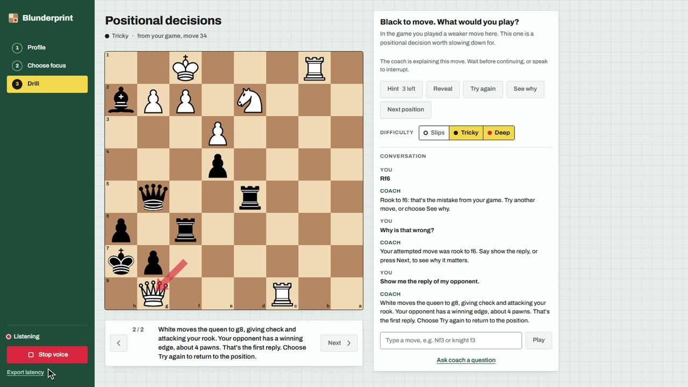

# Voice coaching demo

[Watch or download the video](https://github.com/rohandash13/Blunderprint/releases/download/demo-v2/blunderprint-demo-v2.mp4) · [Try the app](https://useblunderprint.vercel.app)

In Chrome, choose **Try Knight_ofthelight73 → Drill this pattern → Start voice** and allow microphone access. Speak a move, ask why an attempt is wrong, request the reply, then ask to try again.

The recording shows legal-move dots, an immediate stop after a wrong attempt, one narrated reply on request, and a retry with the answer hidden. You can also drag pieces or type moves and questions. Time trouble offers a timed decision drill.

Rohan's supplied recording provides the narration and spoken questions. Those questions were streamed as microphone audio to Deepgram; coach speech and board actions were captured from the deployed app. There are no typed questions or generated presenter voices. This replaces the earlier demo.

The video is hosted as a GitHub release asset to keep the recording out of Git history. The preview above is a frame from the actual recording.
