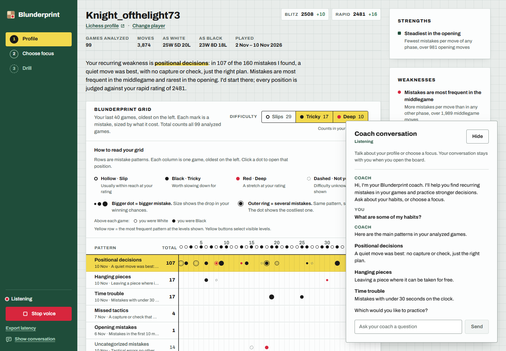
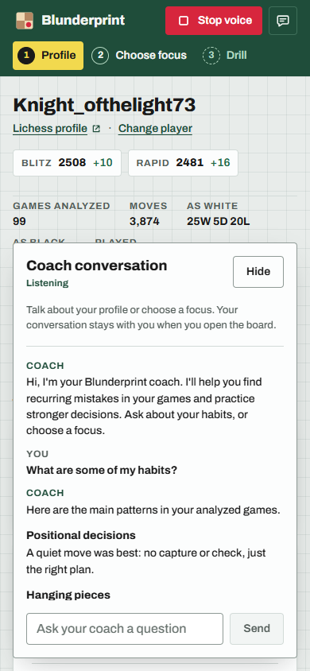

# Coach conversation formatting

The live voice agent was generating Markdown that its speech provider read aloud. A prompt instruction alone reproduced the bug in the spoken integration test, so habit overview requests now use a plain-language summary built directly from verified report patterns. The agent is told that the app already narrates that result. Drill selection remains on its existing path.

The display separately lays out habit names in bold with descriptions beneath them, using a semantic list. Consecutive coach fragments share one speaker label. Existing bold-markup messages render as safe React elements, while user messages remain literal. Signed chess values are preserved.

Regression coverage includes fragmented numbered responses, plain spoken labels, grouping across speaker turns, HTML escaping, signed values, report-based narration and retaining the full speech rules at voice start. The spoken local Chrome check used production report/token endpoints and actual generated microphone PCM: the habit answer had no Markdown, showed a bold list, and had no horizontal overflow at 390px. No player data was fabricated.

The replacement video uses the builder's supplied recording for narration and spoken questions, with actual live coach audio; the earlier generated-presenter video is superseded.

Validation: 226 frontend tests pass, the production build passes and Impeccable reports no findings. The spoken habit test also passed on the deployed Vercel app, including the bold list and phone overflow check. Voice-start updates send only the new context: Deepgram's UpdatePrompt appends to the existing instructions, so repeating the entire base prompt would unnecessarily grow the session. A regression test checks both the initial full rules and bounded updates.
