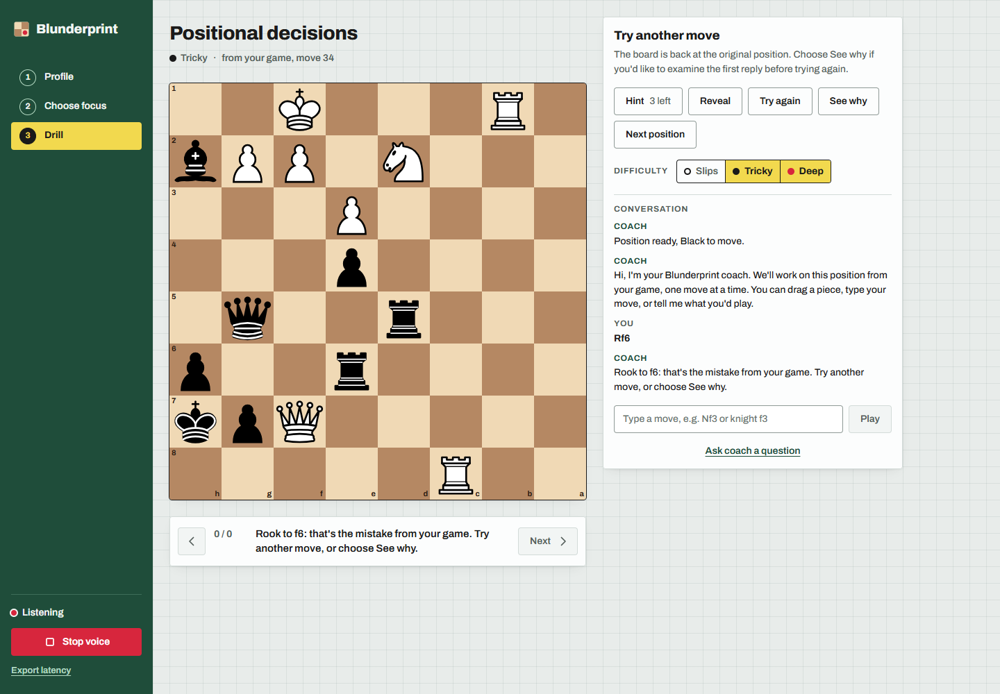
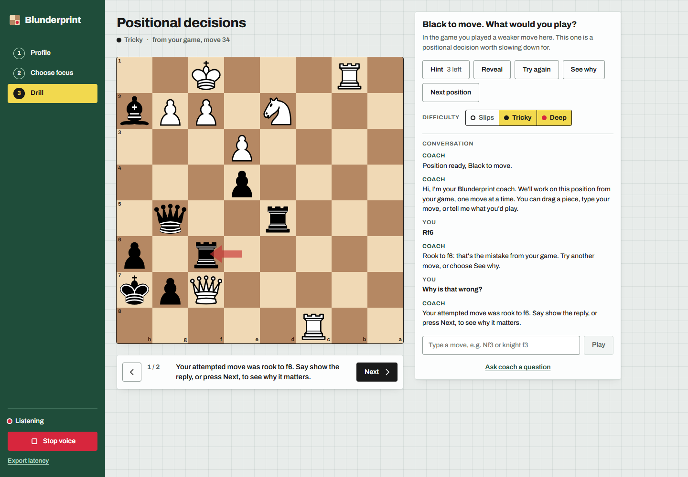
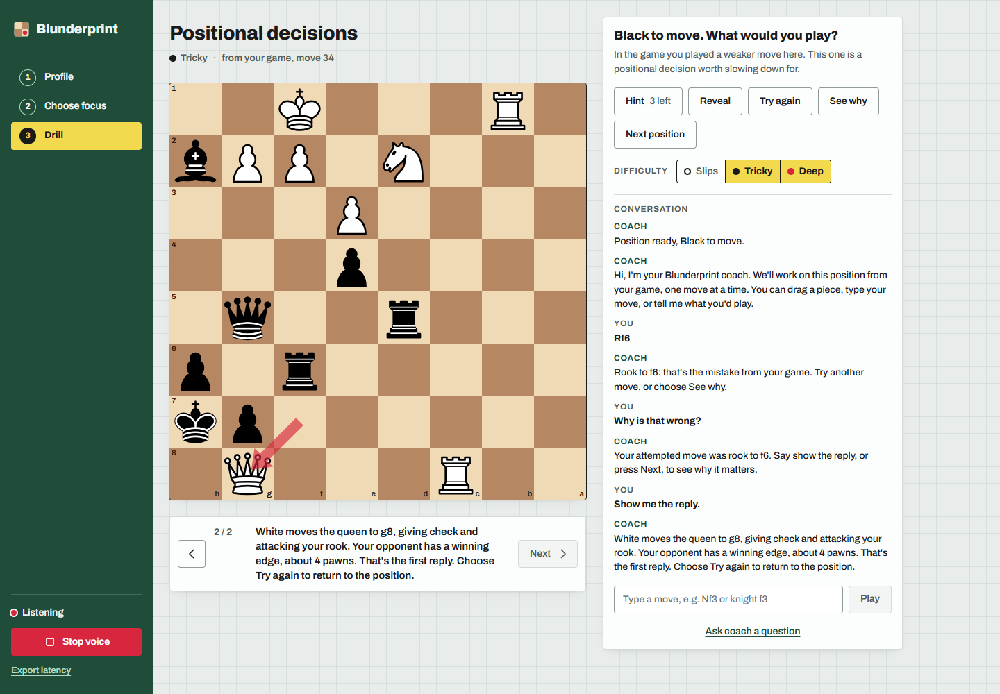
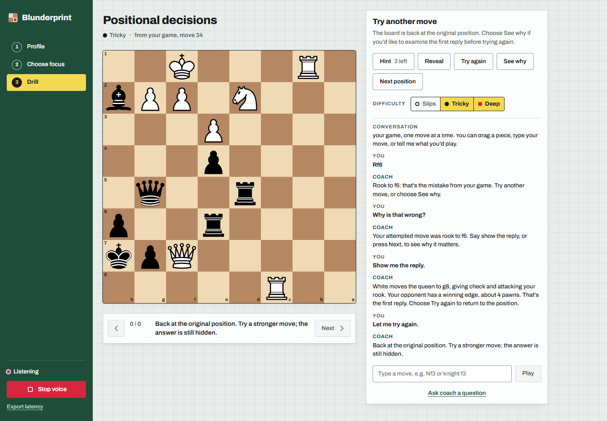

# Guided voice pacing review

The first demo exposed a gap between single-ply tools and actual coaching: the agent could call Next repeatedly without speaking between moves. Prompt instructions alone did not prevent this.

Wrong attempts now reset for another try, with optional See why. Review shows the attempted move and waits for a separate reply request. Only the first engine reply is offered before Try again. Best-line explanations also start with one ply rather than animating a whole variation.

The browser grants one board action per user turn. A matching injected explanation must receive audio, finish streaming, and finish local playback before another action. Unsolicited chained calls are rejected even after playback completes. UI navigation uses the same narration gate; speech or a typed question can interrupt. Start clock stays silent to preserve the decision budget.

## Verification

- Test-first coverage checks immediate wrong-move reset, opt-in first-reply review, single-ply best-line explanation, one action per user turn, unrelated audio/text rejection, playback drain, explicit interruption, and the complete hook's chained-call blocking.
- Local Chrome integration used the real production report/engine/token endpoints and a real Deepgram session. Generated speech was supplied as microphone PCM; no typed move or injected user-text request was used.
- All four spoken stages passed: “Rook to f6,” “Why is that wrong?”, “Show me the reply,” and “Let me try again.” The reply was queen to g8 with check and an attack on the rook, narrated from verified move facts. No automatic continuation or retry occurred.
- Screenshots below capture those real local UI states against production data. They contain no fixtures or generated artwork. Generated test speech is distinct from the user's recording for the replacement video.

Frontend verification: 218 passing tests, production build successful, Impeccable detector returned no findings, and `git diff --check` passed. No backend or model code changed.

Deployment verification is recorded below after rollout. The previous demo MP4 is superseded; replacement editing awaits the user's recorded narration and questions.
